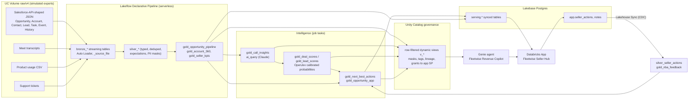

# Fleetwise Seller Hub: one governed Databricks app for 600 sellers

A fleet-telematics SaaS company ("Fleetwise", anonymized; all data synthetic) pays per seat for overlapping
revenue-intelligence, forecasting and customer-360 add-ons on top of its CRM, and its sellers still prep
for calls by hunting across tools whose dashboards are two hours stale. The **Fleetwise Seller Hub** puts
CRM opportunities, call transcripts, product usage and support tickets on one governed Databricks
platform, adds AI that reads every call and scores every deal, and serves it to sellers in milliseconds
from Lakebase, with a Genie copilot for any follow-up question.

## 1. Business problem and quantified value

| Lever | Value | Arithmetic (assumptions labeled in [`docs/VALUE_MODEL.md`](docs/VALUE_MODEL.md)) |
|---|---|---|
| Retire add-on seats (hard savings) | **~$1.08M/yr** (range $0.54M–$1.58M) | 600 sellers × $150/user/month (public list range $75–$220) × 12 |
| Seller time back (capacity) | **~55K hours/yr ≈ 27 sellers** | 600 × 2 h/week × 46 weeks; ÷ 2,000 h/FTE |
| Win more pipeline (upside, proved in pilot, not banked) | **~$6M ACV/yr** | +1 pt win rate × ~$600M worked pipeline |
| Run cost | ~$150K–$250K/yr (assumption) | Measured at demo scale: ~1.65 DBU (≈ $1.15) per incremental run, ≈ $10K/yr hourly, plus Lakebase CU-hours and AI tokens (estimate) |
| Payback (seats only) | **≈ 4 months** (conservative ≈ 9 months) | ($150K build + $200K run) ÷ $1.08M; ($150K + $250K) ÷ $0.54M |

What the build proves (measured, all text evidence in [`evidence/`](evidence/)):

- **Freshness:** a new CRM export file is visible in the seller app **9.0 minutes** after it lands
  (today: ~2-hour batch refresh), measured end to end through every layer ([`evidence/10_e2e.md`](evidence/10_e2e.md)).
- **AI you can measure:** OpenJev deal scores reach **AUC 0.695** on 400 held-out closed deals, with
  **top-decile lift 2.06×** (80% win rate vs 39% base) ([`evidence/06`](evidence/06_nba_and_eval.md)).
  An earlier run scored 0.697 because a post-close CRM field leaked into the "as-of" snapshot; the
  reviewer caught it and 0.695 is the clean number. Call-insight competitor extraction: precision/recall
  1.00/1.00 against planted mentions ([`evidence/04`](evidence/04_call_insights.md)).
- **Operational serving:** Lakebase adds **6.3 ms** p95 over network for a deal lookup (0.07 ms server-side)
  ([`evidence/07`](evidence/07_lakebase.md)); a seller's click in the app lands back in Delta in a **59.1 s**
  round trip (CDC 16.2 s) through Lakehouse Sync.
- **Natural language:** the Genie agent answers **9/10** benchmark seller questions correctly, row-scoped to
  the asking seller ([`evidence/08`](evidence/08_genie.md)).

## 2. What the seller sees

The app (Databricks Apps, AppKit/React + Node, [`app/fleetwise-seller-hub`](app/fleetwise-seller-hub)) is
running at `https://fleetwise-seller-hub-7474646802937769.aws.databricksapps.com` (workspace SSO).
API captures, grants and tests are in [`evidence/09_app.md`](evidence/09_app.md).

1. **My Week** (seller Jordan Rivera): a freshness badge, a KPI strip (quota attainment, pipeline coverage,
   open pipeline for the current fiscal quarter), **Priority deals** ranked by ACV × AI close probability
   with "why" chips, and the **Next best actions** queue with Accept / Done / Dismiss. Each click is an
   OLTP write to Lakebase (`app.seller_actions`) that flows back to Delta and re-weights the next ranking.
   See "`GET /api/home`" and "`POST /api/actions/<action_id>`" in evidence/09.
2. **Deal 360**: the AI score (P(close this quarter), label, confidence, competitive and churn risk), call
   insights from the Meet transcripts (competitors, objections, next steps, summary), the account's usage
   and tickets, contacts with PII masked, and seller notes. See "`GET /api/deals/0060g000000037YAAQ`".
3. **Ask Genie**: an embedded Genie conversation, on-behalf-of the signed-in user, so answers only cover
   that seller's rows; the generated SQL is shown. See "Ask Genie" in evidence/09.

A persona switcher (seller / manager) exists for the demo; it is demo impersonation of a mapped identity,
not an entitlement. The planned **Team (manager) view was cut** for time (the manager persona sees the
team's deals on My Week instead).

## 3. The integrated data journey



One daily Lakeflow job (`seller_superapp_daily`, [`resources/seller_superapp_daily.job.yml`](resources/seller_superapp_daily.job.yml))
runs it all: `generate_data → governance_setup → governance_masks → pipeline_refresh → apply_governance →
governance_comments_tags → ai_call_insights → ai_scoring → writeback_merge → next_best_actions →
lakebase_sync / governance_ai_views / (evaluate_scores if run_eval) → collect_evidence`. Every step is
incremental and idempotent (re-running a batch changes no row counts: [`evidence/10_e2e.md`](evidence/10_e2e.md)).

**Follow one deal through every layer** (Jordan Rivera's top deal `0060g000000037YAAQ`; executed outputs in
[`notebooks/01_walkthrough.ipynb`](notebooks/01_walkthrough.ipynb)):

| Layer | Object | What happens to the deal | Evidence |
|---|---|---|---|
| Raw | `/Volumes/.../raw/v4/salesforce/Opportunity/batch=0000/part-0.json` | Salesforce-API-shaped record lands in the UC volume | [01](evidence/01_generate_data.md), notebook §1 |
| Bronze | `bronze_opportunity` | Auto Loader appends it with `_source_file`, `_ingested_at`, `batch` | [02](evidence/02_pipeline.md), notebook §2 |
| Silver | `silver_opportunities` | Typed, deduped to the latest version (AUTO CDC), expectations enforced | [02](evidence/02_pipeline.md), notebook §3 |
| Gold | `gold_opportunity_pipeline`, `v_opportunity_pipeline` | Joined with account, owner hierarchy and activity; seller sees it only through the row filter | [02](evidence/02_pipeline.md), [03](evidence/03_governance.md), notebook §4 |
| GenAI | `gold_call_insights` | `ai_query` extracts competitors, objections, next steps from its calls | [04](evidence/04_call_insights.md), notebook §5 |
| ML scoring | `gold_deal_scores` | OpenJev returns P(close this quarter), next action, risks with probabilities | [05](evidence/05_scoring.md), [06](evidence/06_nba_and_eval.md), notebook §6 |
| Actions | `gold_next_best_actions` | Ranked actions with a stable `action_id` and a "why" | [06](evidence/06_nba_and_eval.md), notebook §7 |
| Serving | Lakebase `serving.opportunity_pipeline` (synced from `gold_opportunity_app`) | Millisecond point lookup for the app | [07](evidence/07_lakebase.md), notebook §8 |
| NL query | Genie "Fleetwise Revenue Copilot" | Answers "my top deals" on the row-scoped views | [08](evidence/08_genie.md), notebook §9 |
| App | `GET /api/deals/0060g000000037YAAQ` | Deal 360 JSON served to the seller | [09](evidence/09_app.md), notebook §10 |
| Write-back | `app.seller_actions` → `lb_seller_actions_history` → `silver_seller_actions` → `gold_nba_feedback` | The seller's Accept/Dismiss returns to Delta and re-weights ranking | [07](evidence/07_lakebase.md), [09](evidence/09_app.md) |

Unity Catalog lineage (`system.access.table_lineage`) shows the connected graph from bronze to the Lakebase
synced table: `bronze_opportunity → silver_opportunities → gold_opportunity_pipeline → gold_opportunity_app →
serving.opportunity_pipeline`, with `gold_deal_scores → gold_opportunity_app` (edge list in
[`evidence/10_e2e.md`](evidence/10_e2e.md)).

## 4. Decisions and trade-offs

| Decision | Why | Trade-off / alternative |
|---|---|---|
| Simulate Salesforce with API-shaped export files + Auto Loader | No Salesforce org; keeps ingest real (streaming, schema evolution, expectations) | Production path is the Lakeflow Connect Salesforce connector; silver/gold don't change |
| Generative model for extraction (`ai_query`), OpenJev classifier for scoring | Language needs generation; decisions need calibrated probabilities; OpenJev returns 0 output tokens, so it's cheap and fast | One LLM for both: costlier and uncalibrated |
| **What happened:** `ai_decide` blocked → OpenJev called directly | The AI Decide preview isn't enabled in the workspace | Same System One question types over REST from the job; swap to `ai_decide` SQL once enabled |
| **What happened:** no `responseFormat` on the endpoint | The endpoint rejects structured-output params | JSON schema in the prompt + `from_json` validation in SQL; bad rows land in `extract_error` |
| Templated transcripts (no LLM in the generator) | Deterministic, byte-identical data with planted truth to measure against | Less linguistic variety than real calls; AUC/precision are against planted truth, not real-world accuracy |
| Lakebase for app reads and writes; synced tables from gold | Millisecond lookups + OLTP writes without custom ETL | Four pipeline MVs sync as **SNAPSHOT** (TRIGGERED isn't supported on MVs): small tables, full resync each run |
| **Write-back via Lakehouse Sync** (Postgres CDC → UC history table → MERGE) | Managed CDC, governed lineage, measured **59.1 s** round trip | The planned federated Lakebase catalog needed CREATE CATALOG (not granted); kept as an optional fallback in `writeback.sql` |
| Row filters on dynamic views, base gold unfiltered | Row-filtered tables can't be synced-table sources, and synced tables don't carry UC FGAC | The app scopes Postgres queries by the same hierarchy; Postgres RLS is the production hardening step |
| Mask-only PII (no unmasked group); grants to the app SP only | Simplest safe default; nothing shared with broad groups | Unmasked access exists only via `fn_mask_pii_for` in tests/evidence |
| Persona switcher (seller / manager) via `demo_identity_map` | One developer identity must demo several sellers | Demo impersonation, not entitlement; validated endpoint, never "admin" |
| Bundle-managed everything, no `mode: development` | Exact object names for the demo | Schedules aren't auto-paused in dev (no schedules are used) |
| Out of scope | Lakehouse RT, Team/manager view, email drafting | Cut for time; listed in [`docs/BACKLOG.md`](docs/BACKLOG.md) |

**What's simulated, honestly:** the Salesforce export files, the templated Meet transcripts, product usage
and tickets are generated; AUC/lift are measured against the generator's planted truth; the Team view
was cut. Leak guards: lead outcome fields are excluded from lead scoring and masked in lead eval (ruling R11);
the eval's "as-of" snapshot excludes post-close CRM fields.

## 5. AI as force multiplier

Built in about two working days with Claude Code in subagent-driven mode (spec → plan → implementer and
reviewer subagents per task, Databricks skills, a ledger of rulings). The human chose the industry, the
problem and every scope/security call; reviewer subagents caught real bugs (an eval leak, lead outcome
leakage, circular quotas, RLS gaps, `NextStep` wiped on increments). Details:
[`docs/AI_FORCE_MULTIPLIER.md`](docs/AI_FORCE_MULTIPLIER.md).

## 6. How to run

Prerequisites: Databricks CLI with profile `fevm-serverless-stable-s1omq8` (or edit the target in
`databricks.yml`), Python 3.11 venv with `requirements-dev.txt`, Node 20 for the app.

```bash
# 1. Deploy the bundle (schema, volume, pipeline, job)
databricks bundle deploy --select jobs.seller_superapp_daily   # or a full `bundle deploy` on a fresh workspace

# 2. Initial load (+ score evaluation), then daily increments
databricks bundle run seller_superapp_daily --params mode=init,batch=0,dataset_version=v4,run_eval=true
databricks bundle run seller_superapp_daily --params mode=increment,batch=1,dataset_version=v4,run_eval=false

# 3. Lakebase project, synced tables (idempotent)
.venv/bin/python src/lakebase/setup_lakebase.py --action setup \
  --catalog serverless_stable_s1omq8_catalog --schema seller_superapp --profile fevm-serverless-stable-s1omq8

# 4. Genie space (names from databricks.yml defaults; writes src/genie/space_id.txt)
.venv/bin/python src/genie/create_space.py

# 5. App: create, sync source, deploy
databricks apps create fleetwise-seller-hub        # resources/OBO scopes as in resources/fleetwise_seller_hub.app.yml
databricks sync app/fleetwise-seller-hub /Workspace/Users/<you>/apps/fleetwise-seller-hub
databricks apps deploy fleetwise-seller-hub --source-code-path /Workspace/Users/<you>/apps/fleetwise-seller-hub

# 6. After the app SP created Postgres schema `app`: grants to the app SP + Lakehouse Sync CDF config
.venv/bin/python jobs/app_post_deploy.py --profile fevm-serverless-stable-s1omq8
.venv/bin/python src/lakebase/setup_lakebase.py --action setup --with-cdf \
  --catalog serverless_stable_s1omq8_catalog --schema seller_superapp --profile fevm-serverless-stable-s1omq8

# 7. Tests (unit + live integration; governance_mutating tests are opt-in)
.venv/bin/pytest -q -m "not governance_mutating"

# 8. Freshness measurement for a new increment batch
.venv/bin/python scripts/measure_freshness.py --batch 2 --opp <changed opp id> --expect-stage <stage> --out evidence/runs/freshness_batch2.json
```

Job parameters: `mode` (`init` | `increment`), `batch` (int; increments are ≥ 1 and idempotent: a batch
whose manifest exists is skipped), `dataset_version` (`v4`), `run_eval` (`true` runs the offline score
evaluation). No secrets, tokens or workspace URLs are in code; jobs use their run-as identity, the app uses
its service principal plus on-behalf-of-user auth for Genie.

## 7. Evidence index

| File | Claim it proves |
|---|---|
| [`evidence/task1_setup.md`](evidence/task1_setup.md) | Bundle, schema and volume deploy; the test harness talks to the live workspace |
| [`evidence/01_generate_data.md`](evidence/01_generate_data.md) | The generator writes init + increment batches to the volume, byte-identical to a local run, idempotent on re-run |
| [`evidence/02_pipeline.md`](evidence/02_pipeline.md) | The declarative pipeline builds bronze → silver → gold with zero expectation failures and unique silver ids |
| [`evidence/03_governance.md`](evidence/03_governance.md) | Row filters scope each persona, PII is masked and tagged, lineage is recorded in UC |
| [`evidence/04_call_insights.md`](evidence/04_call_insights.md) | `ai_query` extracted structured insights from all 640 calls with 0 errors; incremental re-run is cheap |
| [`evidence/05_scoring.md`](evidence/05_scoring.md) | OpenJev scored 2,979 open deals and 2,566 leads with 0 errors, incrementally |
| [`evidence/06_nba_and_eval.md`](evidence/06_nba_and_eval.md) | NBA ranking is rebuild-safe; deal scores reach AUC 0.695, top-decile lift 2.06× (leak-corrected) |
| [`evidence/07_lakebase.md`](evidence/07_lakebase.md) | 8 synced tables ONLINE with UC/Postgres count parity; 6.3 ms added lookup latency; Lakehouse Sync write-back |
| [`evidence/08_genie.md`](evidence/08_genie.md) | Genie answers 9/10 seller questions, row-scoped to the persona |
| [`evidence/09_app.md`](evidence/09_app.md) | The app is RUNNING; SP grants, second-principal denial, API captures, Genie via OBO, 59.1 s write-back round trip |
| [`evidence/10_e2e.md`](evidence/10_e2e.md) | The full job runs end to end on an increment; lineage connects bronze to the Lakebase table; 9.0-minute freshness; rerun parity |
| [`evidence/11_tests.md`](evidence/11_tests.md) | The full unit + integration test suite passes |
| [`evidence/runs/`](evidence/runs/) | Raw JSON from `collect_evidence` (row counts, lineage edges, task timing) and the freshness measurement |
| [`notebooks/01_walkthrough.ipynb`](notebooks/01_walkthrough.ipynb) | One deal followed through every layer, with executed text outputs |
